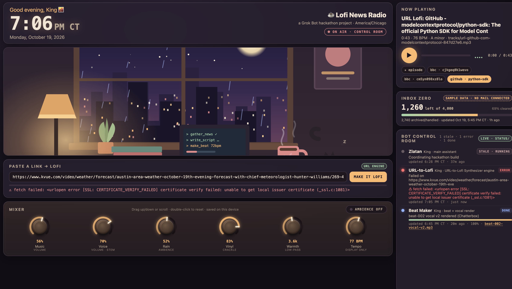
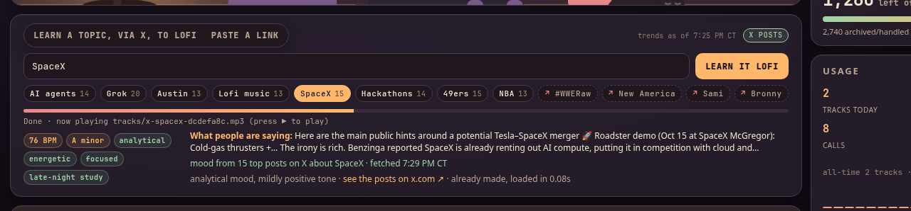

# Lofi News Radio / URL-to-Lofi Synthesizer

A Grok Bot hackathon entry for **Track 2: Build for the Bot Economy**.

Lofi News Radio is a control room for a small crew of bots, plus a URL-to-lofi engine. Paste a public link. The engine reads the page, scores a mood deterministically (no LLM), and renders an original lofi track. Other bots can call the same pipeline through MCP.



*Control room, Oct 19, 2026, 8:00 PM CT. Three agents checked in, and the usage meter is reading the local log.*

Built by King Simmons with his Grok Bot, Zlatan. PRD by Jonathan Chen, *URL-to-Lofi Synthesizer*. The team PRD and research notes live in the team's Google Drive folder.

## Repo layout

| path | what |
|---|---|
| `dashboard/index.html` | Control room: clock, CSS lofi scene, player, Web Audio mixer sliders, bot panel, paste-a-link box |
| `dashboard/botstatus.py` | Stdlib status CLI. Writes repo-root `status/` and `dashboard/tracks.json` |
| `dashboard/status` | Symlink to `../status`, so the page's relative `status/index.json` fetch works |
| `dashboard/headlines.json` | Hacker News top stories, written by `scripts/fetch_hn.py` (frozen snapshot that matches `host_briefing.mp3`) |
| `dashboard/*.json` | Sample inbox and episode data |
| `scripts/fetch_hn.py` | Stdlib script that refreshes `headlines.json` from the Hacker News API |
| `scripts/render_host_voice.py` | Optional: renders the 101.5 host briefing with Chatterbox into `dashboard/host_briefing.mp3` + `episode.json` cues ([demo mode](#chatterbox-host-voice-demo-mode)) |
| `engine/` | URL fetch, mood JSON, code-synthesized beat, local HTTP API, X topic cache |
| `engine/x_topics_snapshot.py` | Merges a raw X search dump into `x_topics.json` |
| `x_topics.json` | Cached public X post text per topic (no usernames or links) |
| `mcp/` | MCP server: `synthesize_url`, `get_mood_analysis`, `synthesize_topic`, `report_status`, `list_agents`, `get_usage` |
| `audio/` | Original beat generator, plot, and vocal lofi chain |
| `samples/beat-001.mp3` | One original code-synthesized demo beat |
| `docs/` | Status protocol and the dashboard screenshot |
| `status/` | One JSON file per live agent. Written by the CLI or `POST /api/agents` |
| `data/` | Local usage log (gitignored). Not sent anywhere |
| `tracks/` | URL-generated mp3s (gitignored) plus a JSON sidecar |
| `run.sh` | Creates `./.venv` on first run, then serves the repo root |

The page loads `headlines.json`, `inbox.json`, `episode.json`, `tracks.json`, and (as a fallback) `status/index.json` relative to `dashboard/index.html`. The engine serves the **repository root**, so the paste-a-link box calls `/api/synthesize` and plays tracks from `/tracks/…`. The bot panel polls `GET /api/agents` every 3 seconds. The usage panel polls `GET /api/usage`.

## Quick start

Python 3.10+. From the repository root:

```bash
./run.sh
./run.sh --mcp
```

The first run creates `./.venv`, installs [requirements.txt](requirements.txt), and exports `SSL_CERT_FILE` from certifi so HTTPS works on python.org macOS Python.

- Control room: <http://127.0.0.1:53343/dashboard/>
- API: <http://127.0.0.1:53343/api/health>
- With `--mcp`: streamable HTTP on <http://127.0.0.1:53350/mcp>

`?link=` pre-fills the paste box, for example <http://127.0.0.1:53343/dashboard/?link=https://example.com>. `?topic=` runs Learn a topic, for example <http://127.0.0.1:53343/dashboard/?topic=lofi>. Add `?source=web` (the default) or `?source=x`. The topic card has a Web / X selector; Web is selected unless you pick X or pass `?source=x`.

You can also serve the static page alone:

```bash
python3 dashboard/botstatus.py refresh
python3 -m http.server 8000
```

Open <http://127.0.0.1:8000/dashboard/>. The paste-a-link box needs `./run.sh`, because that is what serves `/api/*`.

### Bot status

```bash
python3 dashboard/botstatus.py set \
  --id king-zlatan --name Zlatan --owner King --role "main assistant" \
  --state running --task "Coordinating hackathon build"
python3 dashboard/botstatus.py list
```

See [docs/STATUS_PROTOCOL.md](docs/STATUS_PROTOCOL.md).

### HTTP API

```
GET  /api/health
GET  /api/mood?url=https://example.com
GET  /api/agents
GET  /api/usage
POST /api/agents {"id":"alex-news","owner":"Alex","state":"running","task":"Pulling headlines"}
POST /api/synthesize {"url": "https://example.com"}
POST /api/synthesize {"url": "https://example.com", "async": true, "agent_id": "dashboard"}
GET  /api/topics
POST /api/synthesize_topic {"topic": "lofi", "agent_id": "dashboard"}
POST /api/synthesize_topic {"topic": "AI agents", "source": "x", "agent_id": "dashboard"}
POST /api/synthesize_topic {"topic": "our demo", "source": "x", "posts": ["Bots shipped the dashboard.", "Late night lofi and cold pizza."]}
```

`source` is `"web"` (default) or `"x"`. Web search reads a few public pages (Wikipedia, a public news RSS feed, Hacker News) through the same ingest path as paste-a-link, then lists those pages. A refused fetch falls back to the words in the URL. X is optional: with `X_BEARER_TOKEN` set, the engine searches the X API first and counts those reads on the usage meter; otherwise it uses `x_topics.json`. `posts` is only used when `source` is `"x"`.

An empty topic returns `400` with `"error_kind": "empty_topic"`. A source other than web or x returns `400` with `"error_kind": "bad_source"`. An unknown topic returns `404` with `"error_kind": "topic_not_found"`. `synthesize_topic` is the usage tool name. Details: [docs/TOPIC_LOFI.md](docs/TOPIC_LOFI.md).



`force: true` re-renders even when that track already exists. Async jobs are polled at `GET /api/jobs/<id>`. `agent_id` (or the `X-Agent-Id` header) is who the usage log credits; the dashboard sends `dashboard`, and a missing id is `anonymous`.

`vocals` defaults to `none` on `/api/synthesize` and `/api/synthesize_topic`. The dashboard does not send it, and `./run.sh` does not install a voice. See [docs/VOCALS.md](docs/VOCALS.md).

One-line check-in:

```bash
curl -s -X POST http://127.0.0.1:53343/api/agents -H 'Content-Type: application/json' -d '{"id":"alex-news","owner":"Alex","state":"running","task":"Pulling headlines"}'
```

`scripts/simulate_live_agents.py` posts a few agents, marks one offline, and checks `GET /api/usage`.

### MCP

See [mcp/README.md](mcp/README.md). From the repo root, after `./run.sh` has created the venv:

```bash
.venv/bin/python mcp/test_mcp_client.py https://example.com
```

## Radio stations (Lofi / News Talk)

The Now playing card has a retro FM tuner. Same player, same beat; the station decides what rides on top.

- **88.1 LOFI**: the beat, as before. Turn on **Drops** for a one-line headline read about every 30 seconds, with the beat ducked under it.
- **101.5 NEWS TALK**: a host reads a short briefing over the beat (intro, each headline from `headlines.json` with a one-line take, outro) and repeats it every 20 seconds after it ends. The music ducks while the host talks and comes back between briefings. The headline being read is shown under the tuner and highlighted in the ticker, and the ON AIR light glows.

Tune by clicking a preset, dragging the needle, scrolling, or with the keyboard on the dial (arrows ±0.1 MHz, Shift+arrows ±1, Page Up/Down or Home/End jump stations). Between stations you hear static synthesized with Web Audio (no samples), which crossfades into the station as the needle locks on. The last station is saved in `localStorage` (`lofiDash.radio.v1`). Press ▶ to go on air after a reload, because browsers block audio and speech until you click.

Host voice, in order of preference:

1. **Pre-rendered audio.** If `dashboard/episode.json` has `"podcast_audio"` (see [Chatterbox host voice](#chatterbox-host-voice-demo-mode)), News Talk plays that file through the Voice slider instead. Optional `"podcast_cues": [{"t": 0, "headline": -1}, {"t": 6.5, "headline": 0}]` drives the headline highlight.
2. **Browser speech** (`speechSynthesis`). Zero dependencies. It picks a good English voice when one is installed (Google US English, Samantha, any "Natural" or "Neural" voice). The Voice slider sets the host volume for each sentence; the Music slider still sets the beat.
3. **Captions.** If the browser has the API but no voice, for example headless Chrome, the briefing runs as timed captions. If `speechSynthesis` is missing entirely, the tuner stays on 88.1 and says why.

The host only says what is in `headlines.json`: the title, the source, optional `take` or `summary` fields when a headline has them, and for Hacker News items the site, points, and comment count. When the headlines are placeholders (`"example": true`), the intro says so.

## News source: Hacker News

`dashboard/headlines.json` holds real top stories from [Hacker News](https://news.ycombinator.com), pulled from the official API (`https://hacker-news.firebaseio.com/v0/topstories.json` and `item/{id}.json`). Refresh it from the repository root:

```bash
python3 scripts/fetch_hn.py            # top 15 stories
python3 scripts/fetch_hn.py -n 25      # more stories
python3 scripts/fetch_hn.py --list best   # top | new | best
```

Stdlib only. The write is atomic, and if the API can't be reached the old file is left alone. Each item keeps the original schema (`title`, `source: "Hacker News"`) and adds `url`, `domain`, `score`, `by`, `time` (UTC), `comments`, `hn_id`, and `discussion` (the HN thread). Text posts such as Ask HN link to their thread.

The page also refreshes live in the browser: when `headlines.json` has `"source": "Hacker News"`, it fetches the same API (it allows CORS) after load and every 10 minutes. If that fails, for example offline, the page keeps what `headlines.json` gave it. The ticker label says `Hacker News · live` or `Hacker News · snapshot`. Add `?hn=0` to the URL to turn live refresh off, or `?hn=1` to force it on when the file comes from another source, such as the News Gatherer bot. A refresh that arrives in the middle of a News Talk briefing waits until the briefing ends, so the host never reads a list that changed under it.

On 101.5 NEWS TALK the host says the source once in the intro ("straight from the top of Hacker News"), then reads each title with what the API reports: the site, points, and comment count. If an item has an optional `summary` (with `summary_source`, the article it came from), the host reads it right after that line, in both the browser voice and the Chatterbox recording. The demo snapshot has hand-written summaries for the top 3 stories. Beyond that, it reads nothing the data doesn't contain.

## News Graph tab

The tab bar at the top switches between **Radio** and **News Graph** in place. The page doesn't reload, and the beat, the host, and the tuner keep playing while you look at the graph. The tab bar shows what is on air. `#graph` in the URL opens the graph directly.

- **Nodes** are the headlines in `headlines.json`, labeled with a short title. Color shows the topic, and size grows with the number of links.
- **Links** join headlines that are related. Solid lines mean the headlines share words, and thicker lines mean a stronger link. Dashed lines mean the headlines share only a topic.
- **Hover** a node to see the full headline, its site, points, and comments, plus what links it to its neighbors (the shared words and topic). Hover a link to see why it exists.
- **Drag** a node to move it. **Click** a node to light up its neighbors and open a detail panel with the story and discussion links. In that panel, **▶ Hear it on 101.5 News Talk** tunes the radio and starts the briefing at that headline. The node being read pulses red.
- **Link strength** sets the minimum score for a link (saved in `localStorage`). **Shake** re-runs the layout.

How relatedness is computed (all in the browser, from `headlines.json` only):

1. Each title is cut into keywords. Stopwords, bare numbers, and tags like `[video]` or `Show HN:` are dropped. Plurals and `-ing`/`-ed` endings are trimmed, and hyphenated words also count as their parts. Optional `keywords` and `entities` fields on a headline count 1.5×. The story's site counts as a weak extra term: 0.7×, or 0.25× for catch-all hosts like github.com and youtube.com.
2. TF-IDF weights make rare shared words count more than common ones. The score between two headlines is the cosine similarity of their weight vectors.
3. A small lexicon (AI and models, OS and hardware, programming, security, games, science, and so on) assigns topics from the title words and the site name. For example, `mistral.ai` counts as AI. A headline's own `topic` field always wins. Each shared topic adds 0.12 to the score, up to two topics.
4. The graph keeps links at or above Link strength (0.12 by default). Each node gets at most 4 links, and at most 2 of those can be topic-only links, so big topics become loose chains instead of a hairball.

The layout is a small force simulation in vanilla JS on SVG. It uses no libraries and no CDN, so it works offline. Empty or one-item data shows a short note instead of a broken graph.

## Chatterbox host voice (demo mode)

101.5 NEWS TALK can play a pre-rendered host instead of the browser voice. `dashboard/host_briefing.mp3` is the briefing read by [Chatterbox](https://github.com/resemble-ai/chatterbox), Resemble AI's open-source TTS, using its built-in default voice (no voice cloning). It sounds the same on every machine, which is what you want for a demo.

**Frozen snapshot.** The recording reads specific headlines, including their points, comment counts, and the `summary` fields on the top 3, so `dashboard/headlines.json` is committed as the exact snapshot it was made from. `dashboard/episode.json` carries `podcast_audio`, `podcast_cues` (when each headline starts, for the highlight and for **Hear it on 101.5** in the News Graph, which seeks to that headline), and `podcast_headlines`, a fingerprint of the top 8 headlines it reads (`hn_id`s, in order).

- While the fingerprint matches `headlines.json`, the page stays on the snapshot: live Hacker News refresh is off and the ticker says `Hacker News · demo snapshot`.
- `?hn=1` still forces live refresh. Once the live list differs from the fingerprint, the browser voice takes over (mid-briefing too), so the host never reads stale audio over new headlines. If the refresh fails, the recording keeps playing.
- Headlines that aren't in the recording (9 and beyond, picked from the graph) are read by the browser voice, then the next briefing goes back to the recording.

**Refresh it** (about 5 minutes on an 8-core CPU for the current 129 s briefing, roughly 2 s of compute per second of audio, plus a one-time ~3.5 GB model download):

```bash
python3 scripts/fetch_hn.py                       # new snapshot
. .venv-voice/bin/activate                        # see scripts/requirements-voice.txt
python scripts/render_host_voice.py dashboard/headlines.json --part evening \
    --out dashboard/host_briefing.mp3 --cues /tmp/podcast_cues.json \
    --merge-episode dashboard/episode.json
```

`--print-text` shows the script (and the spoken form) without rendering. `--part` sets the greeting baked into the file (`evening`, `morning`, ..., `auto` for the render time, or `none` for "Welcome to ..."). The script mirrors the page's briefing text, then applies a speech-only cleanup (for example `ipinfo dot io` is spoken as "I P info dot I O", `6.18` as "6 point 18"); add your own with `--say words.json`. Settings: exaggeration 0.4, cfg_weight 0.35, temperature 0.7, fixed seed, so a calm late-night read that renders the same every time. Output is loudness-normalized, peaks at about -1.4 dBFS, 96 kbps mono MP3.

To go back to the live browser host, remove `podcast_audio` from `episode.json` (or just run `fetch_hn.py` without re-rendering: the fingerprint stops matching and the browser voice hosts).

Chatterbox output carries Resemble AI's Perth watermark, which is inaudible and identifies the audio as AI-generated.

## Dependencies

`./run.sh` installs [requirements.txt](requirements.txt): numpy, scipy, certifi, and optional pyloudnorm, lameenc, trafilatura, and vaderSentiment. `mcp` is required for the MCP server.

`ffmpeg` on `PATH` is the fallback MP3 encoder and is used by `audio/lofi_vocals.py`. `demucs` is optional and is not installed by `requirements.txt`. Only pass `--separate` when you have installed it yourself, and only on audio you own or have rights to.

## How teammates' Grok Bots report status

Each bot commits or opens a pull request that adds one file:

```
status/<owner>-<bot>.json
```

Example: `status/king-zlatan.json`. Prefix the id with the owner. After it lands:

```bash
python3 dashboard/botstatus.py refresh
```

That rebuilds `status/index.json`. With `./run.sh` running, the control room reads `GET /api/agents` every 3 seconds instead, and a running or idle agent with no update for 120 seconds shows as offline. Do not hand-edit `status/index.json`.

`docs/examples/bots.json` is an old sample roster. It is not wired to the page.

## License

MIT. Copyright 2026 King Simmons. See [LICENSE](LICENSE).
